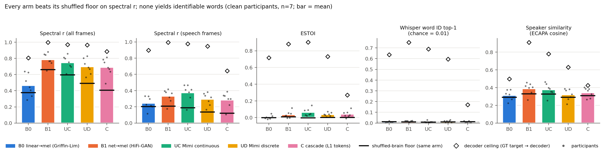
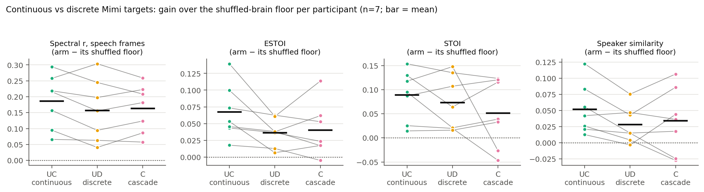
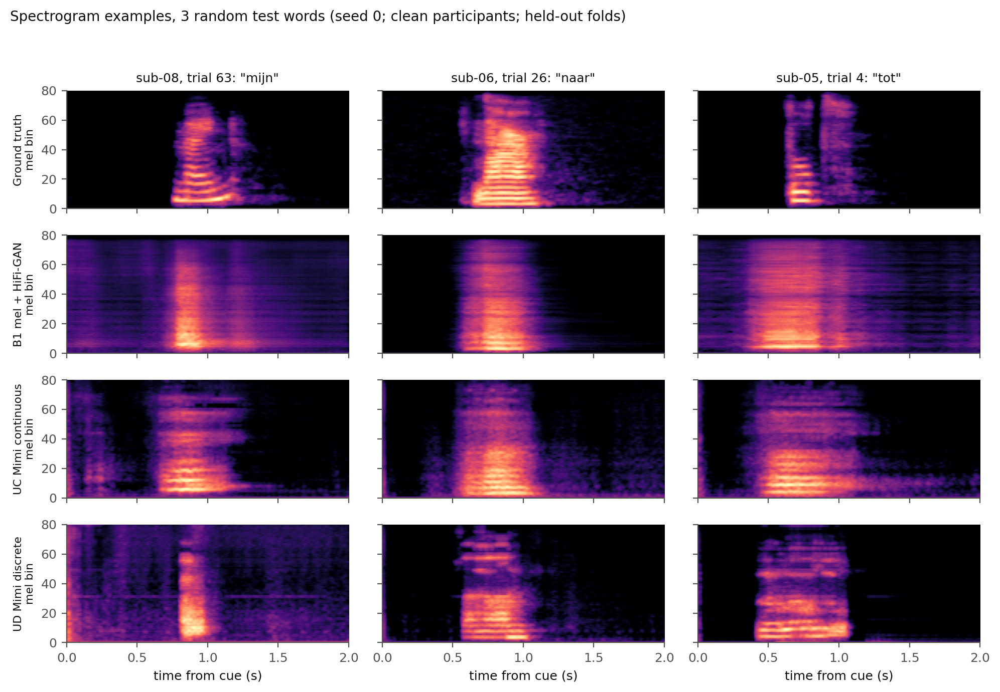

# What Do sEEG Speech Decoders Recover? Continuous vs. Discrete Codec Targets Under Matched Floors and Ceilings

**Saim Chishti** · Bahria University

[](#citation)
[](LICENSE)

Code, result tables and figures for the extended abstract. We decode isolated Dutch words from sEEG into five different
speech targets (mel spectrogram, continuous and discrete neural-codec targets, and a cascade). Every arm is scored
between its own **shuffled-brain floor** and its own **decoder ceiling**.

## TL;DR

- **Acoustics are partly recovered.** The continuous codec latent (UC) recovers the most of its available STOI range:
  15% of the floor-to-ceiling headroom (r_speech 24%). The cascade's nominally larger fractions come from its low ceiling.
- **Words are not recovered.** Closed-set word identification is at chance (1%, 100-way) for every arm, although the
  decoders' oracle ceilings reach 60–75%.
- **Raw spectral r is inflated.** The linear baseline's native spectral r is .73, but the same model trained on
  shuffled brain–audio pairs already gets .70. Most of the correlation is the trial-locked speech/silence envelope.

## The floor-to-ceiling protocol

All five arms share the same backbone, cross-validation folds and hyperparameters, and each arm gets two matched
reference points. The **floor** *F* is the same arm trained with brain–audio pairings permuted (`<arm>_shuf`), then
tested on true pairs. The **ceiling** *C* is the ground-truth target passed through that arm's own decoder (`ORACLE_<arm>`).
A brain score *S* is reported as the fraction of the attainable range it covers:

$$H = \frac{S - F}{C - F}$$

H is computed per participant and is undefined (NA) when *C − F* < 0.05. This separates what the brain signal adds from
what the decoder and trial structure provide for free.

## Main results

Clean cohort: n = 7 participants (sub-03, 04, 05, 06, 07, 08, 10); mean ± SD across participants. r = 23-bin spectral
Pearson r computed from the waveform (all frames); r_speech = speech frames only; WID = Whisper closed-set top-1 (chance
.01); H = headroom. Source: [`results/main_table.csv`](results/main_table.csv),
[`results/headroom.csv`](results/headroom.csv).

| Arm | r | r_speech | STOI | ESTOI | WID | H r_speech | H STOI |
|---|---|---|---|---|---|---|---|
| **B0** linear → 23-bin logMel | 0.465 ± 0.126 | 0.246 ± 0.073 | 0.371 ± 0.047 | 0.003 ± 0.021 | 0.010 ± 0.005 | 0.064 ± 0.037 | -0.035 ± 0.050 |
| **B1** net → mel80 (HiFi-GAN) | 0.786 ± 0.074 | 0.333 ± 0.078 | 0.394 ± 0.059 | 0.035 ± 0.039 | 0.016 ± 0.007 | 0.160 ± 0.049 | 0.050 ± 0.052 |
| **UC** net → Mimi latent (continuous) | 0.748 ± 0.078 | 0.374 ± 0.098 | 0.436 ± 0.054 | 0.065 ± 0.042 | 0.009 ± 0.010 | 0.237 ± 0.095 | 0.148 ± 0.077 |
| **UD** net → Mimi 8 codebooks (discrete) | 0.699 ± 0.089 | 0.294 ± 0.073 | 0.349 ± 0.054 | 0.038 ± 0.021 | 0.013 ± 0.012 | 0.189 ± 0.095 | 0.125 ± 0.086 |
| **C** cascade (level-1 tokens + lookup) | 0.690 ± 0.101 | 0.284 ± 0.087 | 0.307 ± 0.056 | 0.042 ± 0.037 | 0.007 ± 0.009 | 0.320 ± 0.131 | 0.177 ± 0.257 |

<details>
<summary>Floors and ceilings (same columns)</summary>

| Condition | r | r_speech | STOI | ESTOI | WID |
|---|---|---|---|---|---|
| B0_shuf | 0.375 ± 0.117 | 0.204 ± 0.057 | 0.386 ± 0.052 | -0.001 ± 0.011 | 0.013 ± 0.004 |
| B1_shuf | 0.661 ± 0.097 | 0.208 ± 0.055 | 0.365 ± 0.066 | 0.009 ± 0.012 | 0.010 ± 0.005 |
| UC_shuf | 0.595 ± 0.101 | 0.187 ± 0.064 | 0.347 ± 0.040 | -0.003 ± 0.011 | 0.009 ± 0.007 |
| UD_shuf | 0.492 ± 0.152 | 0.137 ± 0.091 | 0.276 ± 0.052 | 0.001 ± 0.007 | 0.012 ± 0.007 |
| C_shuf | 0.406 ± 0.179 | 0.121 ± 0.072 | 0.256 ± 0.036 | 0.001 ± 0.006 | 0.013 ± 0.007 |
| ORACLE_B0 | 0.805 ± 0.062 | 0.896 ± 0.046 | 0.849 ± 0.013 | 0.718 ± 0.020 | 0.636 ± 0.095 |
| ORACLE_B1 | 0.998 ± 0.001 | 0.994 ± 0.001 | 0.936 ± 0.006 | 0.880 ± 0.013 | 0.751 ± 0.119 |
| ORACLE_UC | 0.970 ± 0.008 | 0.977 ± 0.006 | 0.948 ± 0.010 | 0.903 ± 0.021 | 0.689 ± 0.116 |
| ORACLE_UD | 0.966 ± 0.009 | 0.947 ± 0.010 | 0.855 ± 0.010 | 0.731 ± 0.031 | 0.595 ± 0.150 |
| ORACLE_C | 0.884 ± 0.034 | 0.643 ± 0.039 | 0.504 ± 0.020 | 0.269 ± 0.024 | 0.170 ± 0.028 |
| GT | 1.000 ± 0.000 | 1.000 ± 0.000 | 1.000 ± 0.000 | 1.000 ± 0.000 | 0.772 ± 0.109 |

</details>

**Continuous vs. discrete.** After subtracting each arm's own floor, UC > UD on ESTOI in **7/7** participants
(paired two-sided Wilcoxon, uncorrected **p = .016**, Holm-adjusted over five metrics **p = .078**;
[`results/floor_corrected.csv`](results/floor_corrected.csv)). With n = 7, the smallest attainable two-sided Wilcoxon
p is .0156, so no comparison can reach Holm p < .05, however consistent it is.

All 10 participants, per-participant values, paired tests and the HG-band robustness check are in [`results/`](results/).

## Figures

| | |
|---|---|
|  |  |
| **Floor to ceiling.** Bars: brain arms; black line: shuffled-brain floor of the same arm; diamond: decoder ceiling; dots: participants (clean, n = 7). Every arm beats its floor on spectral r; none yields identifiable words. | **Continuous vs. discrete.** Gain over each arm's own shuffled floor per participant for UC, UD and C (r_speech, ESTOI, STOI, speaker similarity). |


**Spectrogram examples.** Ground truth vs. B1, UC and UD decodes for three random held-out words from clean participants (seed 0).

## Data

The dataset is *Dataset of Speech Production in intracranial Electroencephalography* (Verwoert et al., *Sci Data* 2022),
hosted on OSF at <https://osf.io/nrgx6> under CC-BY 4.0. **No data are redistributed in this repository**: no sEEG, no
audio, no features and no decoded outputs.

```bash
mkdir -p data/raw
curl -L -o data/raw/SingleWordProductionDutch-iBIDS.zip https://osf.io/download/g6q5m/   # 2.79 GB
unzip data/raw/SingleWordProductionDutch-iBIDS.zip -d data/raw/                          # ~5.0 GB unzipped
```

Expected layout:

```text
data/
├── raw/SingleWordProductionDutch-iBIDS/
│   ├── participants.tsv
│   └── sub-01 … sub-10/ieeg/sub-XX_task-wordProduction_{ieeg.nwb,channels.tsv,events.tsv,…}
└── features/            # written by src/prep.py and src/targets.py
    ├── sub-XX_feat.npy, sub-XX_spec.npy, sub-XX_procWords.npy, sub-XX_feat_names.npy
    └── sub-XX_trials.npz, sub-XX_targets.npz
```

## Setup

- Python 3.11, Linux. All experiments ran on a single NVIDIA RTX 3090 (24 GB).
- Install with uv (as used) or pip:

```bash
uv venv --python 3.11 .venv && source .venv/bin/activate
uv pip install -r requirements.txt        # or: pip install -r requirements.txt
```

`requirements.txt` pins the full environment, including `torch==2.5.1+cu121` from the PyTorch CUDA 12.1 index.

Pretrained models are downloaded from the Hugging Face Hub on first use into `checkpoints/cache/` (git-ignored):

| Model | Use | Revision |
|---|---|---|
| [`kyutai/mimi`](https://huggingface.co/kyutai/mimi) | codec targets and decoder (UC, UD, C) | `89091b3e466eb6a9d11e537bf26b144f194978f7` |
| [`openai/whisper-large-v3`](https://huggingface.co/openai/whisper-large-v3) | closed-set word ID, CER (via `transformers`) | `06f233fe06e710322aca913c1bc4249a0d71fce1` |
| [`speechbrain/spkrec-ecapa-voxceleb`](https://huggingface.co/speechbrain/spkrec-ecapa-voxceleb) | speaker similarity | `0f99f2d0ebe89ac095bcc5903c4dd8f72b367286` |
| [`speechbrain/tts-hifigan-libritts-16kHz`](https://huggingface.co/speechbrain/tts-hifigan-libritts-16kHz) | mel80 vocoder (B1) | `4d32c6f19e7ff9316c5c56d7903d3d345ddcace4` |

## Reproduce

Run every command from the repository root. The runtimes are approximate, taken from the
[experiment log](docs/EXPERIMENT_LOG.md), on one RTX 3090.

| # | Step | Command | ≈ Runtime |
|---|---|---|---|
| 1 | Preprocess: repo-exact HG features + per-trial tensors | `python src/prep.py` | part of ~25 min for steps 1–2 |
| 2 | Targets: mel80, Mimi latents, Mimi codes | `python src/targets.py` | (see above) |
| 3 | Acoustic contamination audit (+ positive control) | `python src/contamination.py`<br>`python src/contamination.py --posctrl sub-01` | ~10 min |
| 4 | B0 reproduction (repo protocol, 1000 circular shifts) | `python src/b0_repro.py` | ~30 min |
| 5 | Train all arms, floors and oracles (10-fold CV) | `for p in sub-{01..10}; do python src/arms.py $p; done` | ~10 min / participant |
| 5b | HG-band robustness (drop HG-flagged channels) | `for p in sub-03 sub-05 sub-06; do python src/arms.py $p --drop-hg --arms B0,B1,UC,UD,C; done` | ~5 min / participant |
| 6 | Score every condition (STOI/ESTOI, spectral r, MCD, Whisper word ID, ECAPA) | `for p in sub-{01..10}; do python src/score.py $p; done` | ~3 h in total for steps 5–6 (2–3 jobs in parallel) |
| 7 | Aggregate tables + paired tests | `python src/aggregate.py` | < 1 min |
| 8 | Floor-corrected comparisons + headroom | `python src/sp008_floor_headroom.py` | seconds (CPU) |
| 9 | Figures | `python src/figures.py` | ~1 min |

Notes:
- `src/aggregate.py --gate sub-06` reproduces the gate decision (SP-005) for a single participant.
- Whisper scoring needs about 11 GB of VRAM. If you run out of memory, set `WCHUNK=6` (smaller candidate chunks), e.g.
  `WCHUNK=6 PYTORCH_CUDA_ALLOC_CONF=expandable_segments:True python src/score.py sub-03`.
- `arms.py` and `score.py` skip conditions whose outputs already exist, so interrupted runs can be resumed.
- Step 6 writes per-condition scores to `results/scores/`; steps 7–9 write the CSVs in `results/` and the PNG/PDF files
  in `figures/`. Decoded audio (`results/preds/`) is git-ignored and never published.

## Repository structure

```text
.
├── README.md
├── LICENSE                       MIT
├── CITATION.cff
├── THIRD_PARTY_LICENSES.md       MIT notice for code adapted from SingleWordProductionDutch
├── requirements.txt
├── src/
│   ├── prep.py                   features + per-trial tensors
│   ├── targets.py                mel80 / Mimi latent / Mimi code targets
│   ├── contamination.py          acoustic contamination audit (Roussel et al. 2020)
│   ├── b0_repro.py               repo-exact linear baseline reproduction
│   ├── arms.py                   B0, B1, UC, UD, C + shuffled floors + oracle ceilings
│   ├── score.py                  metrics for every condition
│   ├── aggregate.py              tables and paired tests
│   ├── sp008_floor_headroom.py   floor-corrected comparisons and headroom
│   ├── figures.py                figures
│   ├── codecs_util.py            Mimi / HiFi-GAN wrappers
│   └── swp_features.py, MelFilterBank.py, reconstructWave.py   adapted third-party code
├── results/                      CSV/TXT/JSON outputs used in the paper
├── figures/                      PNG + PDF figures
└── docs/EXPERIMENT_LOG.md        full experiment log, SP-000 – SP-008
```

## Contamination audit

We test for acoustic leakage of the speech signal into the sEEG recordings, following Roussel et al. (2020). For each
channel we correlate the sEEG and audio log-spectrograms at matching frequencies (10–500 Hz) and compare the mean
diagonal against 10,000 frequency permutations. A participant is flagged if any channel passes Bonferroni correction or
the channel-averaged matrix has p < .01. **sub-01, sub-02 and sub-09 were flagged**
([`results/contamination/summary.csv`](results/contamination/summary.csv)), so all main claims use the remaining **7
clean participants**. Results for all 10 participants are also reported. Effect sizes are small everywhere. Removing the
channels flagged in the high-gamma band (sub-03, 05, 06) changes the scores by at most .03 and leaves the main contrasts
unchanged ([`results/hg_robustness.txt`](results/hg_robustness.txt)).

## Limitations

- One dataset (Verwoert et al. 2022), with **isolated words** only, not continuous speech.
- **n = 7** clean participants, which bounds the attainable p-values (see above).
- Voices in the dataset are **pitch-shifted** per participant, so speaker similarity is measured against the shifted voice.
- Word identification is **closed-set** (participant vocabulary, 100-way), not open-vocabulary recognition.
- Hyperparameters were **fixed a priori, not tuned**, and are identical across arms.

## Future directions

- **Cross-participant encoders**: pool participants to escape the per-subject data limit.
- **Generative codec-latent decoding**: sample codec latents with a conditional generative model instead of regressing them.
- **RL with an intelligibility reward**: optimise decoders directly for word recoverability.
- **Larger sentence datasets**: test whether continuous targets keep their edge on continuous speech.

## Citation

```bibtex
@inproceedings{chishti2026seeg,
  title     = {What Do {sEEG} Speech Decoders Recover? Continuous vs. Discrete Codec Targets Under Matched Floors and Ceilings},
  author    = {Chishti, Saim},
  booktitle = {AI4BCI 2026 (extended abstract)},
  year      = {2026}
}
```

Please also cite the dataset:

```bibtex
@article{verwoert2022dataset,
  title   = {Dataset of Speech Production in intracranial Electroencephalography},
  author  = {Verwoert, Maxime and Ottenhoff, Maarten C. and Goulis, Sophocles and others},
  journal = {Scientific Data},
  volume  = {9},
  pages   = {434},
  year    = {2022},
  doi     = {10.1038/s41597-022-01542-9}
}
```

## Acknowledgements

We thank Verwoert et al. and the Neural Interfacing Lab for making the sEEG dataset and the SingleWordProductionDutch
code openly available, and the authors of Mimi (Kyutai), Whisper (OpenAI), SpeechBrain (ECAPA-TDNN, HiFi-GAN), PyTorch,
Hugging Face Transformers and pystoi.
